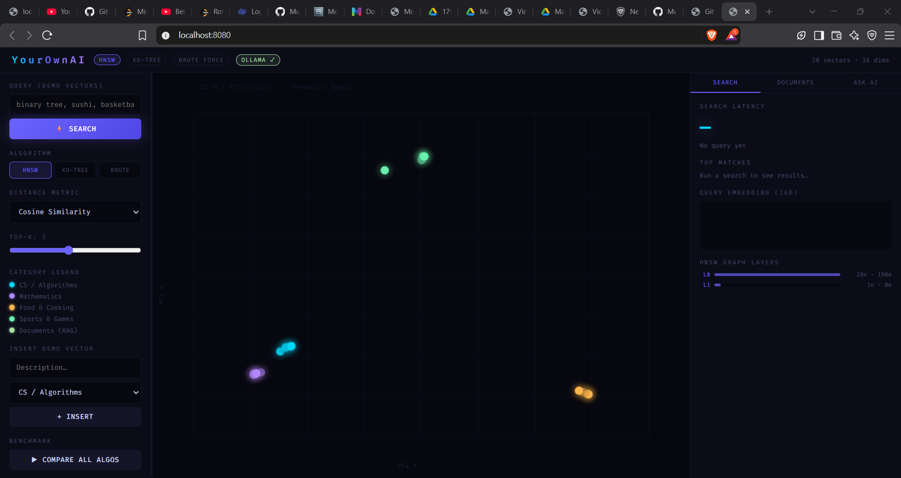
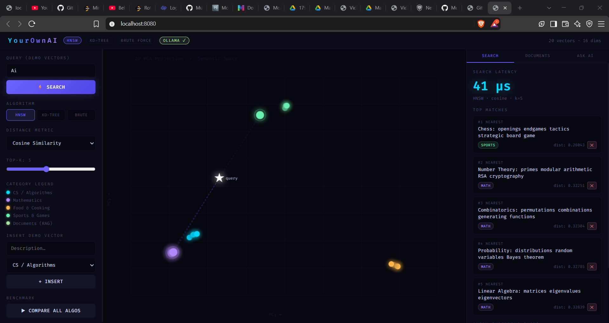
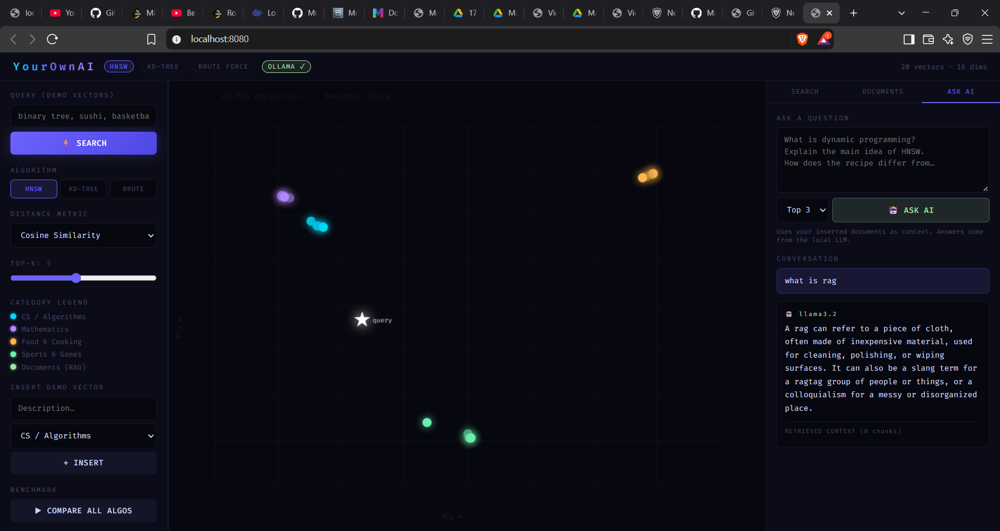

# YourOwnAI — Explore Vector Search and Local RAG

An interactive C++ vector-search project with a browser-based UI for exploring nearest-neighbour algorithms, visualizing demo vectors, and experimenting with document retrieval and local LLM answers through Ollama.

**Repository:** [MuneesAhmed/Your-Own-AI](https://github.com/MuneesAhmed/Your-Own-AI)  
**Local app:** `http://localhost:8080` after starting the server.

> **Project status:** Educational prototype. The UI and selected flows have been demonstrated locally. Performance, retrieval quality, persistence, security, and production readiness have not yet been independently validated. See [Limitations and validation](#limitations-and-validation).

## Why I built it

Vector search is a core building block behind semantic search and retrieval-augmented generation (RAG). This project makes those ideas tangible: you can compare multiple search strategies, inspect nearby vectors in a 2D projection, insert text to create embeddings, and ask questions that use retrieved document chunks as context.

## Highlights

- **Compare three search strategies:** HNSW, KD-Tree, and brute-force nearest-neighbour search.
- **Try distance metrics:** cosine similarity, Euclidean distance, and Manhattan distance.
- **Explore vector relationships:** interactive 2D scatter plot for the bundled demo vectors.
- **Generate real text embeddings locally:** uses Ollama's `nomic-embed-text` model for document ingestion.
- **Experiment with a local RAG flow:** retrieves document chunks and passes them to `llama3.2` for answer generation.
- **Inspect the backend through HTTP endpoints:** search, insertion/deletion, statistics, algorithm information, document operations, and benchmarking.
- **Learn by comparing:** a benchmark view lets you compare the implemented search paths on the current dataset.

## Screenshots

### Vector Search Dashboard



### Semantic Search



### Algorithm Comparison



## Architecture at a glance

```text
Browser UI (index.html)
        │ HTTP requests
        ▼
C++ HTTP server (main.cpp, cpp-httplib)
        ├── Demo vector index
        │     ├── Brute-force search
        │     ├── KD-Tree search
        │     └── HNSW search
        │
        └── Document / RAG flow
              ├── Ollama embedding model: nomic-embed-text
              ├── Chunked document embeddings
              ├── HNSW-based candidate retrieval
              └── Ollama generation model: llama3.2
```

More detail: [Architecture and implementation notes](docs/ARCHITECTURE.md).

### Important distinction: demo vectors vs. document embeddings

The search visualization shown in the UI is seeded with a small set of **20 demo vectors of 16 dimensions**. The document workflow calls Ollama to create real text embeddings; the configured model is `nomic-embed-text`. These are separate paths and should not be described as one shared dataset. Verify the embedding dimension returned by the installed Ollama model and the current implementation before changing models.

## Tech stack

| Layer | Technology | Role |
|---|---|---|
| Backend | C++17 | Vector-search implementations and HTTP routes |
| HTTP | `cpp-httplib` single header | Local HTTP server and Ollama HTTP calls |
| Frontend | HTML, CSS, JavaScript | Search controls, result panels, and vector visualization |
| Embeddings | Ollama + `nomic-embed-text` | Local text-to-vector conversion |
| Generation | Ollama + `llama3.2` | Local answer generation for the RAG flow |
| Tooling | g++, Git, PowerShell | Build and run on Windows |

## Run locally on Windows

### Requirements

- Windows 10/11
- Git
- A C++17-compatible `g++` compiler (for example, MSYS2 UCRT64 GCC)
- [Ollama](https://ollama.com/download)
- Enough RAM and disk space for the selected local models; generation speed depends on your machine

### 1. Clone this repository

```powershell
git clone https://github.com/MuneesAhmed/Your-Own-AI.git
cd Your-Own-AI
```

### 2. Install the models

Start Ollama if it is not already running, then run:

```powershell
ollama pull nomic-embed-text
ollama pull llama3.2
ollama list
```

### 3. Compile

From the repository root, run:

```powershell
g++ -std=c++17 -O2 main.cpp -o db.exe -lws2_32
```

If your compiler reports that `httplib.h` cannot be found, confirm that the header is in the repository root. If `g++` is not recognized, install GCC and add its `bin` directory to your Windows `PATH`, then open a new terminal.

### 4. Start the app

If Ollama is already running in the background, do not start a second server. Otherwise, in one terminal run:

```powershell
ollama serve
```

In another PowerShell terminal, from the repository root run:

```powershell
.\db.exe
```

Open **http://localhost:8080** in your browser.

### 5. Try the main workflows

1. **Search:** try a query such as `binary tree` or `basketball`; switch between HNSW, KD-Tree, and brute force.
2. **Benchmark:** compare the available search strategies on the current demo dataset. Repeat runs and use larger controlled datasets before drawing performance conclusions.
3. **Documents:** insert a short note and confirm that the document count increases.
4. **Ask AI:** ask a question that the inserted note can answer, then inspect the retrieved context. A successful UI response alone does not prove that the answer is grounded or correct.

## HTTP API

The local server exposes routes implemented in `main.cpp`. Check the current source for exact query parameters and response schemas before building clients against them.

| Method | Route | Purpose |
|---|---|---|
| `GET` | `/search` | Nearest-neighbour search over demo vectors |
| `POST` | `/insert` | Add a demo vector |
| `DELETE` | `/delete/:id` | Delete a demo vector by ID |
| `GET` | `/items` | List demo vectors |
| `GET` | `/benchmark` | Compare the search implementations |
| `GET` | `/hnsw-info` | Inspect HNSW graph information |
| `GET` | `/stats` | Retrieve demo-index statistics |
| `POST` | `/doc/insert` | Embed and store a document's chunks |
| `GET` | `/doc/list` | List stored document records |
| `DELETE` | `/doc/delete/:id` | Delete a document chunk/record |
| `POST` | `/doc/search` | Retrieve relevant document chunks |
| `POST` | `/doc/ask` | Retrieve context and ask the local LLM to generate an answer |
| `GET` | `/status` | Inspect Ollama status and configured model names |

The server is intended for local experimentation. Do not expose it to the public internet without adding authentication, authorization, input validation, rate limits, and appropriate network controls.

## Engineering concepts demonstrated

- Exact versus approximate nearest-neighbour search
- Graph-based indexing (HNSW) and space partitioning (KD-Tree)
- Distance/similarity metrics
- Embedding generation and vector retrieval
- Chunk-based retrieval-augmented generation
- C++ HTTP service integration with a local model runtime
- Interactive visualization and comparative benchmarking

## Limitations and validation

This is a learning project, not a production vector database or a verified RAG product. Before making stronger claims, validate and document:

- **Search correctness:** compare HNSW and KD-Tree results against brute force on the same generated datasets; report recall@k and edge cases.
- **Benchmark methodology:** test several dataset sizes and dimensions, warm-up runs, repeated trials, and median/percentile latency. Separate index-build time from query time. The UI's microsecond display is not enough by itself to establish a meaningful speed advantage.
- **RAG quality:** test with known-answer documents, inspect retrieved chunks, and record failures such as unsupported answers, missing context, or irrelevant retrieval.
- **Persistence:** restart the process and confirm whether vectors/documents survive. Do not promise persistence unless it is implemented and tested.
- **Input and API safety:** test malformed JSON, empty text, oversized requests, invalid IDs, and Ollama being unavailable.
- **Scalability:** the bundled 20-vector demo is illustrative, not evidence of large-scale performance.

## Repository hygiene

Do not commit generated binaries or build artifacts such as `db.exe`, `main.obj`, or object files. The updated `.gitignore` covers common build outputs. If these files are already tracked, remove them from Git's index once (without deleting your local copies):

```powershell
git rm --cached db.exe main.obj
 git add .gitignore README.md docs
 git commit -m "Improve project documentation and repository hygiene"
 git push
```

If Git reports that either generated file is not tracked, omit that filename from the `git rm --cached` command. Review `git status` before committing.

## Attribution and licensing

This repository's Git history includes an `upstream` remote pointing to [`perryvegehan/Your-OWN-AI`](https://github.com/perryvegehan/Your-OWN-AI). Preserve appropriate upstream attribution and review the upstream license and dependency notices before claiming independent authorship or adding a license. Do not describe this as written entirely from scratch unless that is accurate and supportable.

## Next improvements

- Add reproducible automated tests for distance metrics, insertion/deletion, and search correctness.
- Add a benchmark script that emits machine-readable CSV results.
- Add a small evaluation set for retrieval quality and answer grounding.
- Document persistence behavior and error handling.
- Add a short demo video and the four clean screenshots listed above.
